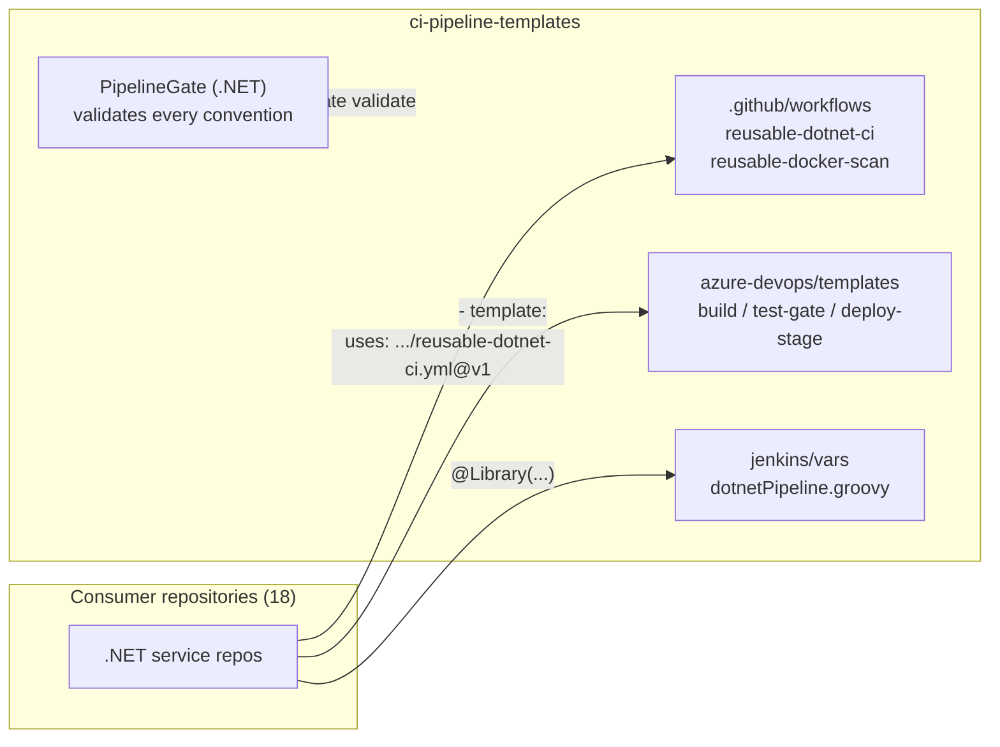

# ci-pipeline-templates

[](https://github.com/TiagoR85/ci-pipeline-templates/actions/workflows/ci.yml)
[](https://github.com/TiagoR85/ci-pipeline-templates/actions/workflows/codeql.yml)
[](LICENSE)
[](https://dotnet.microsoft.com/)

Reusable CI/CD recipes for .NET teams across GitHub Actions, Azure DevOps
and Jenkins — with a DEV/HOM/PROD approval flow and a coverage quality
gate. I keep every pipeline convention in one versioned place; the
repositories in my portfolio consume these workflows instead of
copy-pasting YAML.

## About this repository

This is a **study project** from my public portfolio. I learn by building: I use **AI-assisted development tools** (agent-based pair programming) while holding the project to production standards - automated tests, CI quality gates, security scanning, review pipelines and documented architecture decisions.

The scenario is simple on purpose; the engineering is not.

## Architecture



Design rationale lives in [`docs/adr/`](docs/adr/).

## Quickstart

Validate every template in this repo (same gate CI runs):

```bash
git clone https://github.com/TiagoR85/ci-pipeline-templates.git
cd ci-pipeline-templates
docker compose up --build --exit-code-from validate
# expected: OK: all pipeline templates passed validation.
```

> This repo ships a one-shot validator job instead of an HTTP service, so
> the compose quickstart reports success through the exit code (ADR-0004).

### Use it from a GitHub Actions workflow

```yaml
jobs:
  tests:
    uses: TiagoR85/ci-pipeline-templates/.github/workflows/reusable-dotnet-ci.yml@v1
    with:
      test-project: tests/MyService.Tests/MyService.Tests.csproj
```

Optional inputs: `dotnet-version` (default `10.0.x`), `coverage-threshold`
(default `80`, checked **per module** — exclude sub-projects you don't
measure via coverlet's `Exclude`), `runs-on`, `build-command`,
`pre-restore-command`, and `test-filter` (e.g. `TestCategory!=E2E` for
tests that need external secrets).

### Use it from a Node/Astro repository

```yaml
jobs:
  verify:
    uses: TiagoR85/ci-pipeline-templates/.github/workflows/reusable-node-ci.yml@v1
    with:
      test-command: npm run test:coverage   # the coverage threshold lives in the project config
      build-command: npm run build
```

### Use it from Azure DevOps (`azure-pipelines.yml`)

```yaml
stages:
  - template: azure-devops/templates/deploy-stage.yml
    parameters:
      environment: PROD
      dependsOn: Deploy_HOM
```

Approvals are attached to the ADO Environments DEV/HOM/PROD (ADR-0002).

One-time setup: in Azure DevOps open **Environments → Create environment** for
`DEV`, `HOM` and `PROD`, then **Approvals and checks → Add check → Approval**
on `PROD` (and `HOM` if you want a second gate). The pipeline only references
the environment name; the check lives with the environment.

### Use it from Jenkins

```groovy
@Library('ci-pipeline-templates@v1') _
dotnetPipeline(solution: 'app.slnx', testProject: 'tests/T.csproj')
```

PROD approval = the `input` step in your `Jenkinsfile` (ADR-0003).

### Use it from any repository (documentation gate)

```yaml
jobs:
  docs:
    uses: TiagoR85/ci-pipeline-templates/.github/workflows/reusable-doccheck.yml@v1
```

Runs [`doccheck`](https://github.com/TiagoR85/doccheck) on push/PR: section,
version, secret and stack rules — deterministic and offline, no API key in CI.
Inputs: `doccheck-ref` (default `v0.4.0`, pin it for reproducibility), `path`,
`fail-on-findings` (default `true`; set `false` for a report that never breaks
the build), `python-version`, `runs-on`.

## The pipeline-gate tool

```bash
dotnet run --project src/PipelineGate -- validate .
```

| Rule family | Checks |
|---|---|
| `GHA-*` | reusable workflows declare `workflow_call`; every workflow declares `permissions` |
| `AZD-*` | sample covers DEV/HOM/PROD; deploy jobs bind to an `environment`; test template wires `Threshold=` |
| `JEN-*` | declarative `pipeline {}`, `@Library` load, manual `input` approval, `call()` in `vars/` |

## Tests and coverage gate

```bash
dotnet test tests/PipelineGate.Tests/PipelineGate.Tests.csproj -c Release `
  -p:CollectCoverage=true -p:CoverletOutputFormat=cobertura `
  -p:Threshold=80 -p:ThresholdType=line
```

## Decisions

- [ADR-0001 — reusable workflows over composite/marketplace](docs/adr/0001-reusable-workflows-over-actions.md)
- [ADR-0002 — approvals via ADO Environments](docs/adr/0002-azure-devops-environment-approvals.md)
- [ADR-0003 — Jenkins shared library](docs/adr/0003-jenkins-shared-library.md)
- [ADR-0004 — dogfood self-validation](docs/adr/0004-dogfood-self-validation.md)

## Roadmap

- [x] Reusable GitHub Actions workflows with coverage gate
- [x] Azure DevOps DEV/HOM/PROD templates with environment approvals
- [x] Jenkins shared library with manual PROD approval
- [x] PipelineGate conventions validator + containerized quickstart
- [ ] Publish PipelineGate as a `dotnet tool` on NuGet
- [ ] Terraform module for ADO environments/approvals bootstrap

## License

MIT — see [LICENSE](LICENSE).
